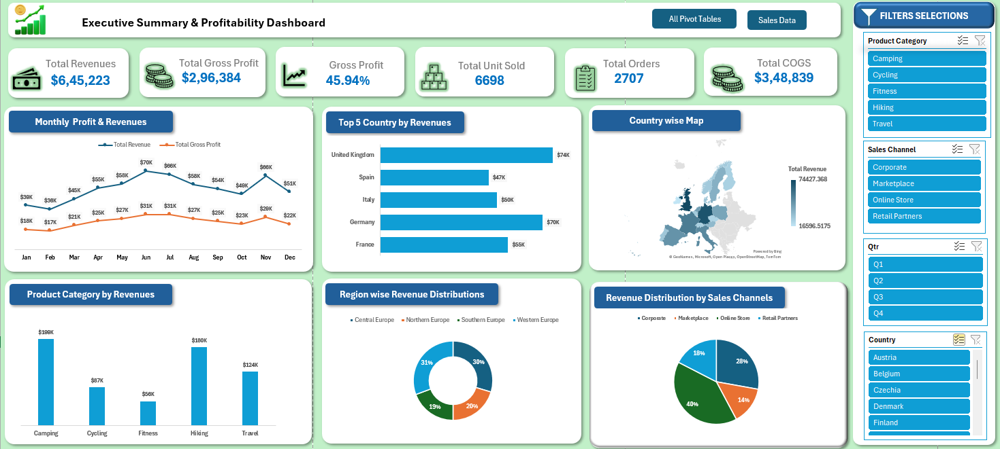

Excel-Sales-Profitability-Dashboard-Project
Interactive Excel Sales &amp; Profitability Dashboard featuring revenue analysis, gross profit, country-wise performance, product category insights, sales channel distribution, and dynamic slicers.

📊 Executive Summary & Profitability Dashboard | Excel

📌 Project Overview

This project showcases an interactive **Sales and Profitability Dashboard** developed using Microsoft Excel.

The dashboard provides a comprehensive overview of business performance through key performance indicators (KPIs), interactive charts, and dynamic slicers. It helps analyze revenue, gross profit, sales performance, product categories, geographical performance, and sales channels.

🎯 Dashboard Features
1. Key Performance Indicators (KPIs)
- Total Revenue
- Total Gross Profit
- Gross Profit Percentage
- Total Units Sold
- Total Orders
- Total Cost of Goods Sold (COGS)

2. Sales & Profitability Analysis
- Monthly Profit & Revenue Trends
- Top 5 Countries by Revenue
- Country-wise Revenue Map
- Product Category Revenue Analysis
- Region-wise Revenue Distribution
- Revenue Distribution by Sales Channels

3. Interactive Filters
The dashboard includes interactive slicers to filter data by:
- Product Category
- Sales Channel
- Quarter (Q1, Q2, Q3, Q4)
- Country

🛠️ Tools & Technologies

- Microsoft Excel
- Pivot Tables
- Pivot Charts
- Excel Slicers
- Data Visualization
- KPI Analysis
- Geographic Map Charts

📈 Business Insights
This dashboard helps users:
- Monitor overall sales and profitability.
- Identify top-performing countries.
- Compare monthly revenue and gross profit.
- Analyze revenue contribution by product categories.
- Understand regional sales performance.
- Evaluate sales channel contribution.
- Explore business performance using interactive filters.

## 📷 Dashboard Preview

## 🎓 Skills Demonstrated

- Data Analysis
- Data Visualization
- Business Intelligence
- Dashboard Development
- Microsoft Excel
- Sales Performance Analysis
- Profitability Analysis

👨‍💻 Author
Prince Kumar

Aspiring Data Analyst | Excel | SQL | Power BI | Data Visualization

